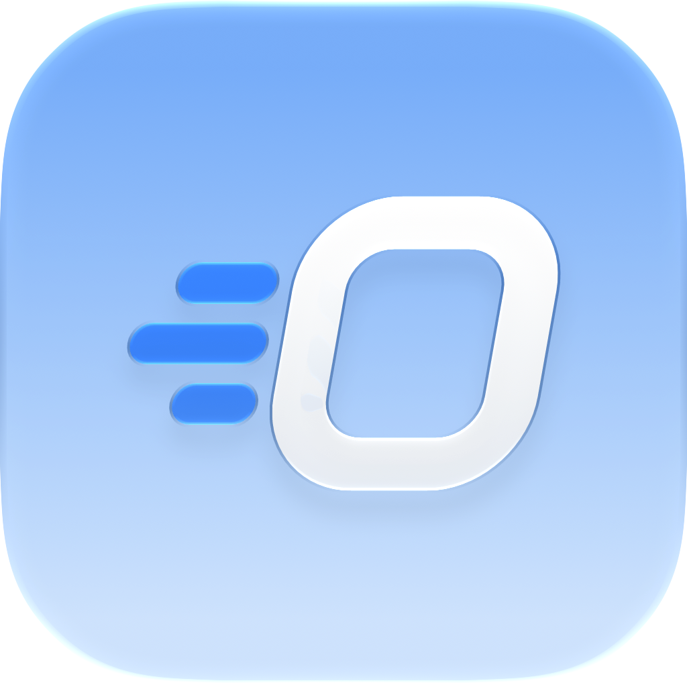
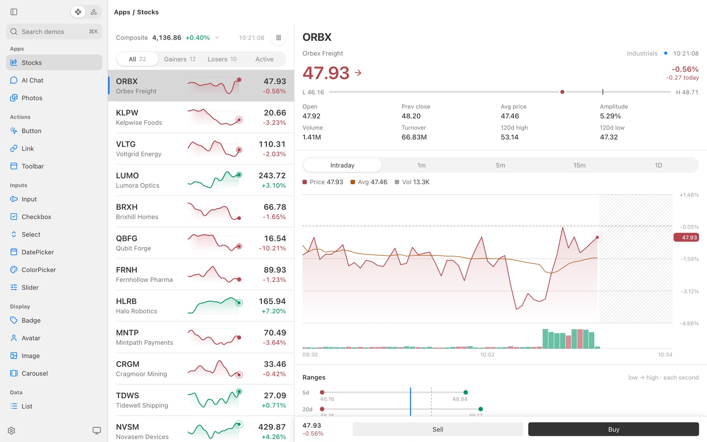
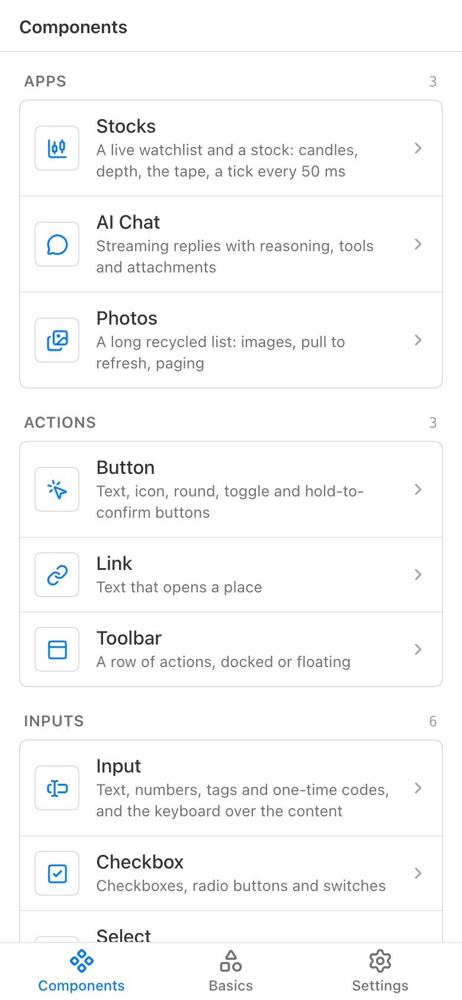

<p align="center">
  
</p>

<h1 align="center">NSGo</h1>

<p align="center">
  <strong>English</strong> |
  <a href="README.zh-CN.md">简体中文</a>
</p>

<p align="center">
  <a href="https://github.com/oneo-me"></a>
  <a href="https://oneo.me"></a>
  <a href="https://x.com/oneo666"></a>
  <a href="https://github.com/sponsors/oneo-me"></a>
</p>

<p align="center">
  A cross-platform native UI engine with a Go backend: app logic, the reactive graph and layout run in Go, and each platform draws with its own native UI.<br>
  It follows the design of <a href="https://nsh.dev">Native Shell (NSH)</a>, for teams that want NSH's model without writing Rust.
</p>

<p align="center">
  
  
</p>

## Status

NSGo is early, with no release or stable API yet. It runs on macOS, iOS, tvOS, watchOS, Windows, Linux, the web, Android and WeChat mini programs, and apps embed in iOS, Android and Go desktop apps of their own; [ARCHITECTURE.md](ARCHITECTURE.md#platforms) tracks each target.

## Getting started

With Go 1.26 or later, and Xcode for iOS, tvOS and watchOS, create an app and run it with hot reload:

```sh
go mod init example.com/hello
go get github.com/oneo-me/nsgo
go get -tool github.com/oneo-me/nsgo/cmd/nsgo
go tool nsgo init   # -template tsx for a TSX app
go tool nsgo dev    # -target web, ios_simulator, tvos_simulator, watchos_simulator, android or miniprogram to run elsewhere
```

An app is Go components that return elements, with signals updating what reads them:

```go
func Root(cx *core.Scope) core.Node {
	count := core.NewSignal(cx, 0)
	return core.View{Style: core.Style{Padding: core.All(24), Gap: 12}, Children: []core.Node{
		core.Text{ContentFunc: func() string { return fmt.Sprintf("Pressed %d times", count.Get()) }},
		base.Button{
			OnPress:  func(core.PressEvent) { count.Update(func(n int) int { return n + 1 }) },
			Children: []core.Node{core.Text{Content: "Press me"}},
		},
	}}
}

func main() { nsgo.Run(Root) }
```

## Documentation

The [docs](https://oneo-me.github.io/nsgo/docs/) cover components and state, TSX apps, localization, testing, building and shipping; the [live demo](https://oneo-me.github.io/nsgo/gallery/loader.html) runs the gallery in the browser.

## Development

```sh
go tool nsgo dev examples/gallery   # run the gallery
go tool nsgo check                  # vet every package
go tool nsgo test                   # every package's tests
```

[Contributing](https://oneo-me.github.io/nsgo/docs/contributing/) has the rest of the setup. Read [ARCHITECTURE.md](ARCHITECTURE.md) and [AGENTS.md](AGENTS.md) before changing code, and [CHANGELOG.md](CHANGELOG.md) for what changed.

## License

Licensed under the [Apache License, Version 2.0](LICENSE). NSGo is a port of NSH, and [NOTICE](NOTICE) records the attribution that port owes.

Unless you explicitly state otherwise, any contribution intentionally submitted for inclusion in NSGo by you, as defined in the Apache-2.0 license, shall be licensed under Apache-2.0, without any additional terms or conditions.
