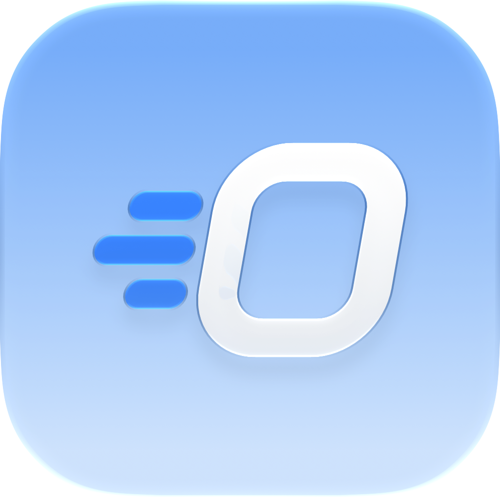
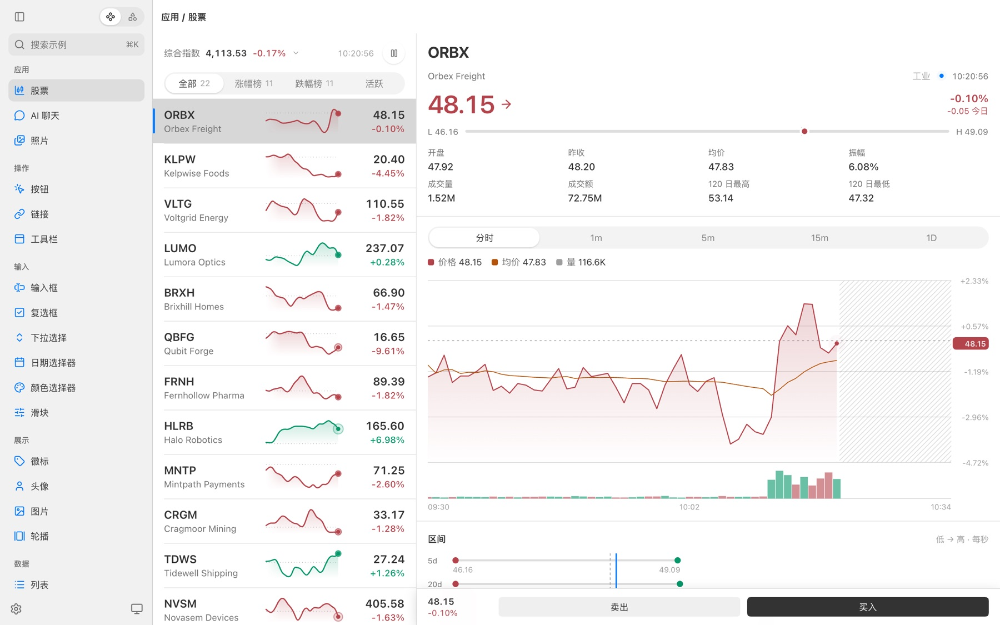
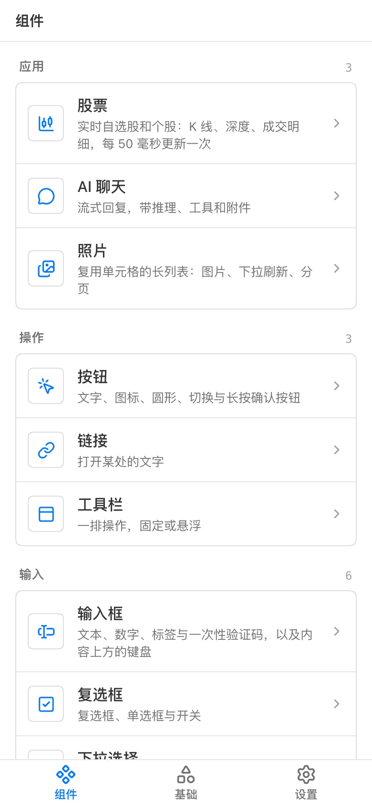

<p align="center">
  
</p>

<h1 align="center">NSGo</h1>

<p align="center">
  <strong>简体中文</strong> |
  <a href="README.md">English</a>
</p>

<p align="center">
  <a href="https://github.com/oneo-me"></a>
  <a href="https://oneo.me"></a>
  <a href="https://x.com/oneo666"></a>
  <a href="https://github.com/sponsors/oneo-me"></a>
</p>

<p align="center">
  以 Go 为后端的跨平台原生 UI 引擎：应用逻辑、响应式图和布局在 Go 中运行，各平台使用自己的原生 UI 绘制。<br>
  它参考 <a href="https://nsh.dev">Native Shell（NSH）</a> 的设计，面向想要 NSH 的模型、但不想写 Rust 的团队。
</p>

<p align="center">
  
  
</p>

## 状态

NSGo 处于早期阶段，尚无发布版本或稳定的 API。它可在 macOS、iOS、tvOS、watchOS、Windows、Linux、Web、Android 以及微信、QQ、支付宝和抖音小程序上运行，应用也可嵌入独立的 iOS、Android 和 Go 桌面应用；各平台进度见 [ARCHITECTURE.md](ARCHITECTURE.md#platforms)。

## 快速开始

安装 Go 1.26 或更新版本（构建 iOS、tvOS 和 watchOS 还需 Xcode）后，创建应用并以热重载方式运行：

```sh
go mod init example.com/hello
go get github.com/oneo-me/nsgo
go get -tool github.com/oneo-me/nsgo/cmd/nsgo
go tool nsgo init   # 加 -template tsx 创建 TSX 应用
go tool nsgo dev    # 加 -target web、ios_simulator、tvos_simulator、watchos_simulator、android 或 miniprogram_wechat 在别处运行
```

应用由返回元素的 Go 组件构成，signal 变化时只更新读取它的部分：

```go
func Root(cx *core.Scope) core.Node {
	count := core.NewSignal(cx, 0)
	return core.View{Style: core.Style{Padding: core.All(24), Gap: 12}, Children: []core.Node{
		core.Text{ContentFunc: func() string { return fmt.Sprintf("Pressed %d times", count.Get()) }},
		base.Button{
			OnPress:  func(core.PressEvent) { count.Update(func(n int) int { return n + 1 }) },
			Children: []core.Node{core.Text{Content: "Press me"}},
		},
	}}
}

func main() { nsgo.Run(Root) }
```

## 文档

[文档](https://oneo-me.github.io/nsgo/zh/docs/)介绍组件与状态、TSX 应用、本地化、测试以及构建与发布；[在线体验](https://oneo-me.github.io/nsgo/gallery/loader.html)可在浏览器中运行 gallery。

## 开发

```sh
go tool nsgo dev examples/gallery   # 运行 gallery
go tool nsgo check                  # 检查所有包
go tool nsgo test                   # 运行所有包的测试
```

其余的开发环境配置见[参与开发](https://oneo-me.github.io/nsgo/zh/docs/contributing/)。修改代码前请先阅读 [ARCHITECTURE.md](ARCHITECTURE.md) 和 [AGENTS.md](AGENTS.md)，变更记录见 [CHANGELOG.md](CHANGELOG.md)。

## 许可证

本项目以 [Apache License 2.0](LICENSE) 授权。NSGo 是 NSH 的移植，[NOTICE](NOTICE) 记录了移植所需的署名。

除非你明确声明，否则你提交给 NSGo 的任何贡献，按 Apache-2.0 许可证的定义，均以 Apache-2.0 授权，不附加任何额外条款或条件。
