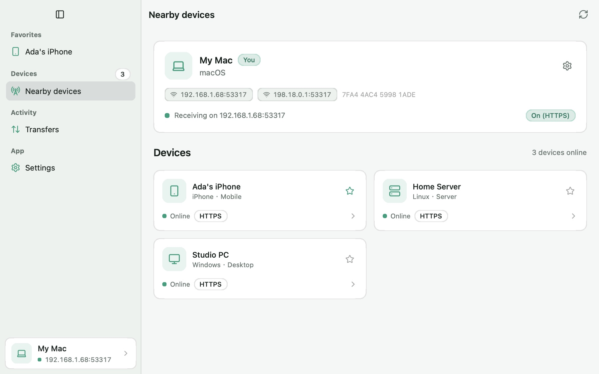

# Cases

The apps the website's [Showcases](https://nsgo.dev/showcases/)
page lists, one Markdown document per app in English, and a translation in
the language's folder (`zh/` for Simplified Chinese) where there is one.
The site reads every Markdown document here but this one, and every
document under a language folder.

To add yours, copy a case and change it: its name as `#`, a paragraph on
what the app does, a list of its details, and a screenshot beside it in
this folder.

```md
# Your app

What it does, in one sentence.

- platforms: iOS, macOS, Web
- site: https://example.com
- source: https://github.com/you/your-app
- author: Your name


```

`platforms` lists the site's platform names, comma-separated: `iOS`,
`App Clips`, `tvOS`, `watchOS`, `macOS`, `Android`, `Windows`, `Linux`,
`Web`, `WeChat`, `QQ`, `Alipay` and `Douyin`. `site`, `source` and `author`
are optional; a screenshot is not, and belongs beside the document with a
reasonably small JPEG, PNG or WebP. A pull request with the document and
the image is all it takes.

## Translations

A page shows an app's English document in a language that has no
translation. To translate one, add a document with the English
document's file name under the language's folder, with the name, the
paragraph and, optionally, a screenshot and its description. Details stay
in the English document, which the translation keeps:

```md
# Hando

在附近的手机和电脑之间通过局域网发送文件、文件夹和消息，使用 LocalSend 协议，不需要服务器或账号。


```

A screenshot a translation names is looked up beside it first, then beside
the English document, so a translation can reuse the English screenshot
with a description of its own, or keep a screenshot of its language's UI
in its folder. A translation without a screenshot shows the English one.
