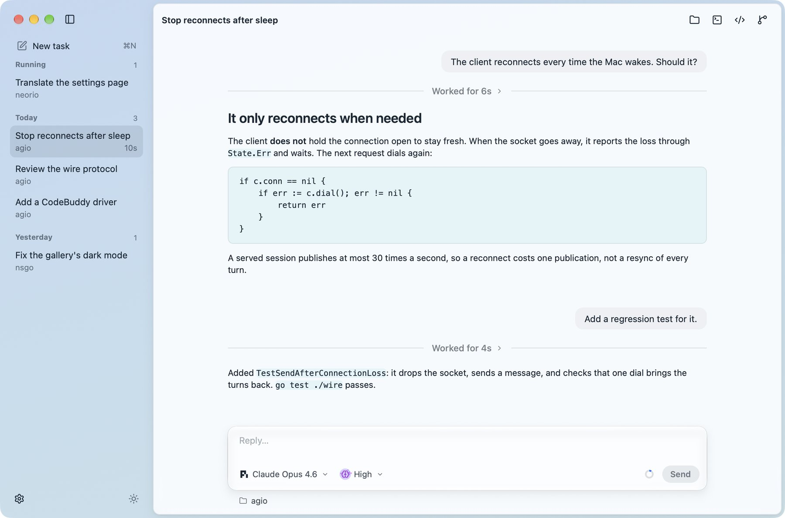

# Agio

Run coding agents such as pi, Codex, Claude Code and CodeBuddy Code in tasks grouped by project, and a library other NSGo apps build their own agent tools on, with drivers, a host, a wire protocol and conversation views for phones and desktops.

- platforms: macOS, Windows, Linux
- site: https://oneo-me.github.io/nsgo-agio/
- source: https://github.com/oneo-me/nsgo-agio
- author: ONEO

