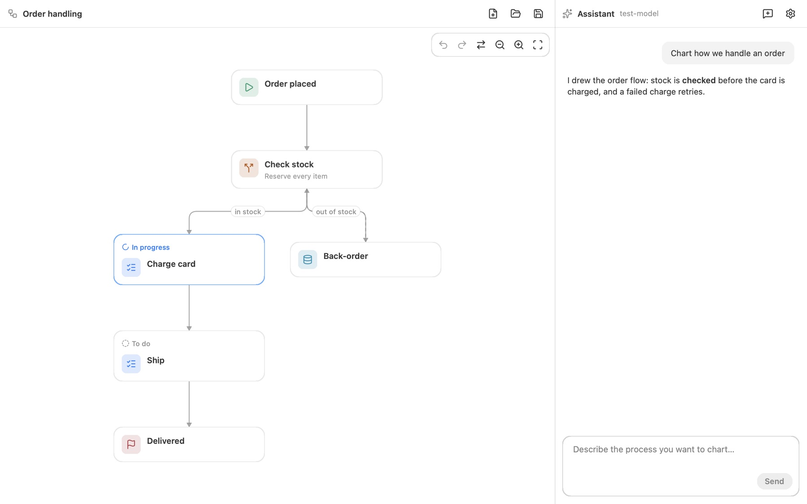

# Flow Editor

Design an app's screens and flow charts by talking with an AI assistant that draws them as you agree, saved as plain-text `.flow` files.

- platforms: macOS, Windows, Linux
- site: https://oneo-me.github.io/nsgo-flow/
- source: https://github.com/oneo-me/nsgo-flow
- author: ONEO

