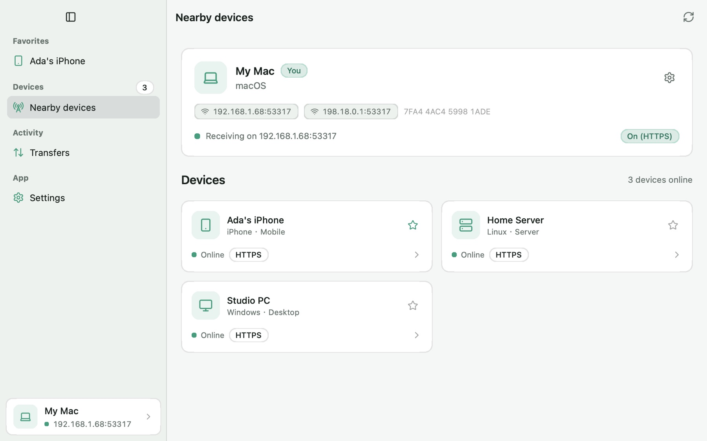

# Hando

Send files, folders and messages between nearby phones and computers over the local network, speaking the LocalSend protocol with no server or account.

- platforms: iOS, macOS, Android, Windows, Linux
- site: https://oneo-me.github.io/nsgo-hando/
- source: https://github.com/oneo-me/nsgo-hando
- author: ONEO

