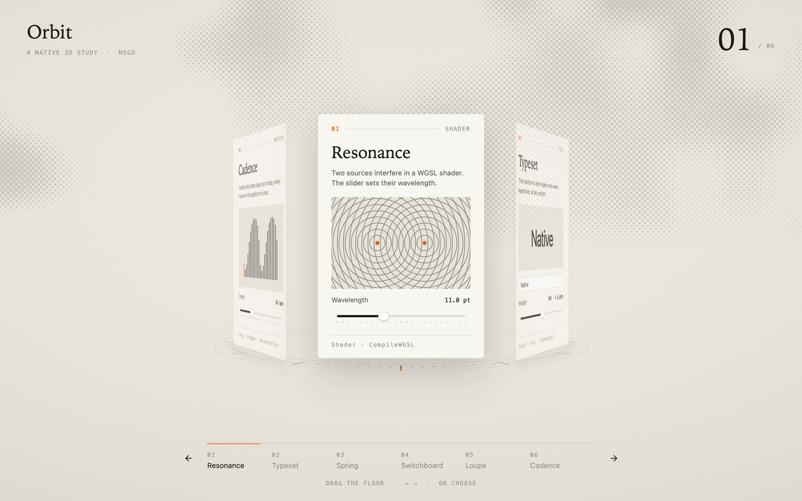

# Orbit

Six cards turn on a 3D floor: WGSL shaders, type, spring physics and a pointer that pulls the floor with it.

- platforms: iOS, macOS, Web
- source: https://github.com/oneo-me/nsgo/tree/main/examples/orbit
- author: ONEO

