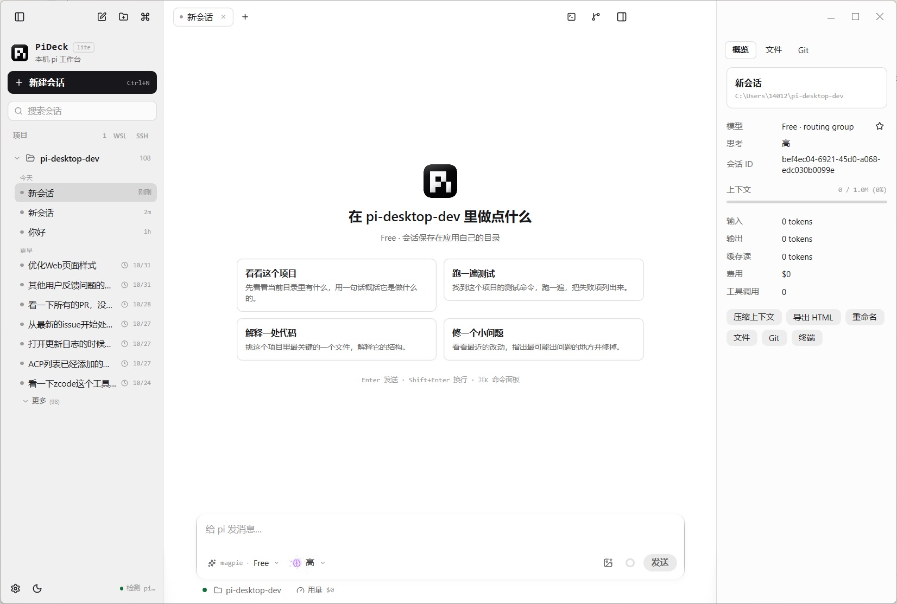

# PiDeck Lite

A native desktop workbench for the `pi` coding agent: projects and sessions in a sidebar, chats in tabs, and a file editor, Git panel and terminal beside them, driving `pi` on this machine, in WSL or over SSH, with a phone app that connects to it remotely.

- platforms: macOS, Windows, Linux, iOS, Android
- source: https://github.com/ayuayue/PiDeck-Lite
- author: ayuayue

