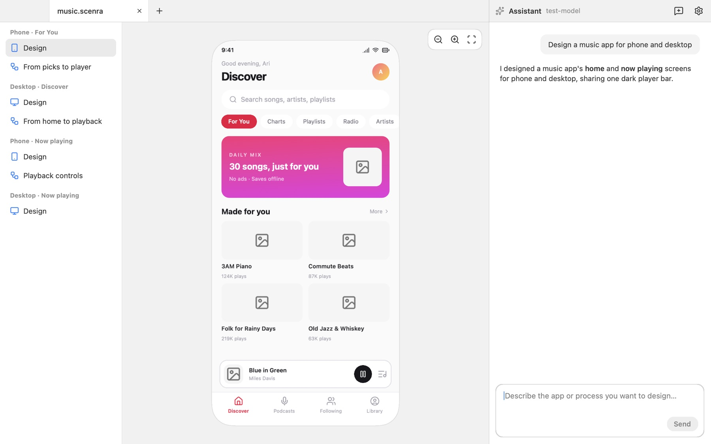

# Scenra

Design apps and the flows between their screens by talking: an AI assistant draws phone, tablet and desktop designs and flow charts as you agree, saved as plain-text `.scenra` files.

- platforms: macOS, Windows, Linux
- site: https://oneo-me.github.io/nsgo-scenra/
- source: https://github.com/oneo-me/nsgo-scenra
- author: ONEO

