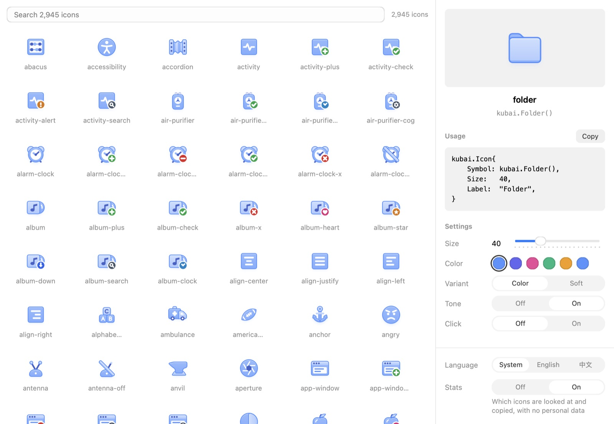

# Components

The component libraries the website's [Components](https://nsgo.dev/components/)
page lists: NSGo's own add-ons and the community's, one Markdown document
each in English, and a translation in the language's folder (`zh/` for
Simplified Chinese) where there is one. The site reads every Markdown
document here but this one, and every document under a language folder.

To add yours, copy the Kubai Icons document and change it: its name as
`#`, a paragraph on what it gives an app, a list of its details, and a
screenshot beside it in this folder.

```md
# Your component

What it gives an app, in one sentence.

- kind: Icons
- package: github.com/you/your-component
- site: https://example.com
- source: https://github.com/you/your-component
- author: Your name
- official: true


```

`kind` is a short word for what it provides, such as `Icons`, `Charts` or
`Widgets`, and `package` is the Go import path apps `go get`; both are
required. The screenshot answers what a reader gets, such as the
library's gallery or a view using it. `site`, `source`, `author` and
`official` are optional; `official: true` marks one NSGo maintains. A `source` at a GitHub
repository's root shows the repository's stars. The
screenshot belongs beside the document as a reasonably small JPEG, PNG or
WebP. A pull request with the document and the image is all it takes.

## Translations

A page shows a library's English document in a language that has no
translation. To translate one, add a document with the English
document's file name under the language's folder, with the name, the
paragraph and, optionally, a screenshot and its description. A
translation gives `kind` in its language; the other details stay in the
English document, which the translation keeps:

```md
# Kubai Icons

2,945 个分层图标，使用应用的主题色，可以显示角标，悬停时会有动画，为 NSGo 应用而做。

- kind: 图标


```

A screenshot a translation names is looked up beside it first, then beside
the English document, so a translation can reuse the English screenshot
with a description of its own, or keep a screenshot of its language's UI
in its folder. A translation without a screenshot shows the English one.
