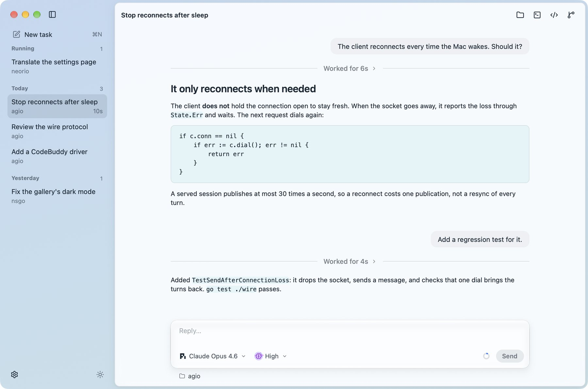

# Agio

Drivers, a host, a wire protocol and conversation views for phones and desktops, for NSGo apps that run coding agents such as pi, Codex, Claude Code and CodeBuddy Code, in one process or as a server and its clients.

- kind: Agents
- package: github.com/oneo-me/nsgo-agio
- site: https://oneo-me.github.io/nsgo-agio/
- source: https://github.com/oneo-me/nsgo-agio
- author: ONEO

