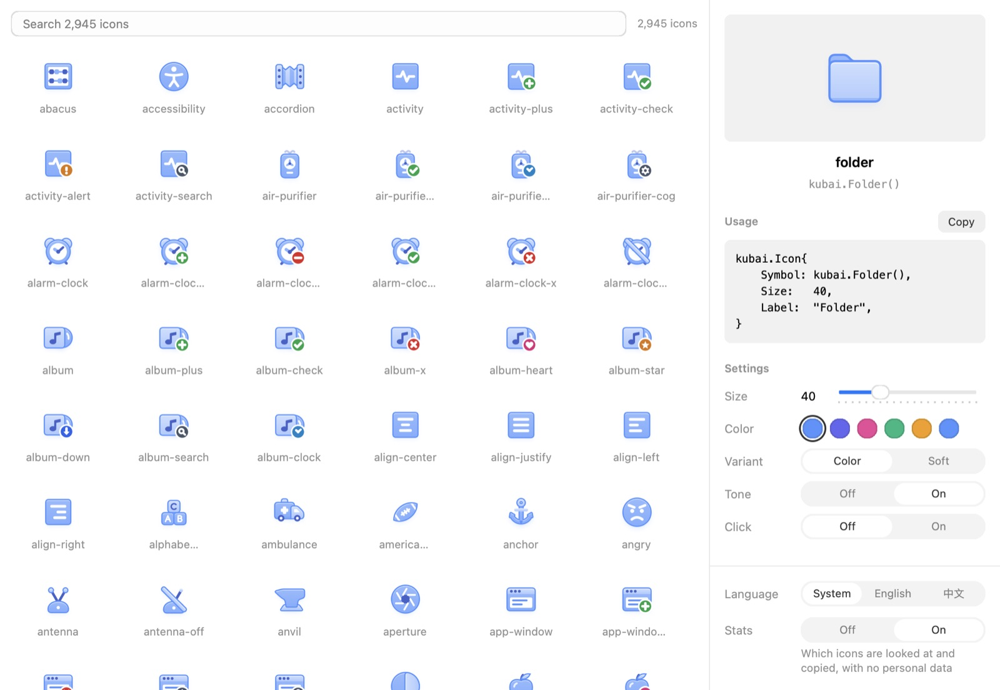

# Kubai Icons

2,945 layered icons that take the app's accent, show badges and move on hover, for NSGo apps.

- kind: Icons
- package: github.com/nsgo-dev/nsgo-icons-kubai
- site: https://nsgo-dev.github.io/nsgo-icons-kubai/
- source: https://github.com/nsgo-dev/nsgo-icons-kubai
- author: ONEO
- official: true

